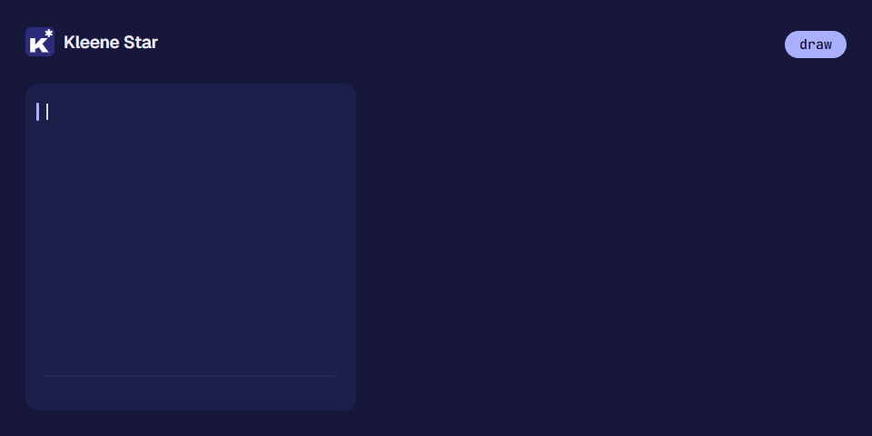
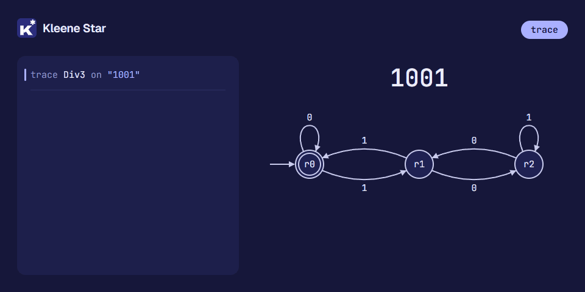

<p align="center"></p>

<h1 align="center">Kleene Star</h1>

<p align="center">
A small language for Theory of Computation: draw machines in text, then ask questions about them.
</p>

<p align="center">
<a href="https://github.com/Pratham71/kleene-star/actions/workflows/ci.yml"></a>
<a href="https://github.com/Pratham71/kleene-star/releases/latest"></a>
<a href="LICENSE"></a>
</p>

Kleene Star is named after the star in `a*`. You write DFAs, NFAs, regular
expressions, grammars, pushdown automata and Turing machines the way you
draw them on paper, and the language converts, combines, compares, traces
and tests them. The command is `kstar` and programs live in `.kstar` files.

<p align="center"></p>

## A first program

An NFA for binary strings that end in `01`, made deterministic and minimal,
then checked against the regular expression for the same language:

```kstar
alphabet B = {0, 1}

nfa EndsIn01 over B {
    start  a
    accept c
    a --0,1--> a
    a --0-->   b
    b --1-->   c
}

let d = minimize(EndsIn01)

print d
test d accepts "1101"
test equivalent(d, /(0|1)*01/)
```

`kstar run ends_in_01.kstar` prints the minimal DFA as a table (`->` marks
the start state, `*` the accepting ones) and the result of the tests:

```text
DFA with 3 states over {0, 1}
          | 0     | 1
->  {a}   | {a,b} | {a}
    {a,b} | {a,b} | {a,c}
   *{a,c} | {a,b} | {a}
tests: 2 passed, 0 failed
```

## Watch it work

You write a machine the way you would draw it, one transition per line, and
`draw` turns it into a state diagram (a Graphviz `.dot` file):

<p align="center"> r1 draws that labelled edge, adding states r1 and r2 as they are first named. The last line, draw Div3, prints wrote Div3.dot."></p>

`trace` runs a machine on a word and shows every step, so you can see why
it accepts or rejects:

<p align="center"></p>

## Install

| On | Run |
|---|---|
| Windows | Download and run `kstar-setup-x64.exe` from the [latest release](https://github.com/Pratham71/kleene-star/releases/latest), or in PowerShell: `powershell -c "irm https://raw.githubusercontent.com/Pratham71/kleene-star/main/install.ps1 \| iex"` |
| Linux, macOS | `curl -fsSL https://raw.githubusercontent.com/Pratham71/kleene-star/main/install.sh \| sh` |
| From source | `cargo install --path . --locked` in a clone of this repository |

Then open a new terminal and run `kstar version`. The installer and the
scripts check the download's SHA-256 checksum and need no administrator
rights. The [installation guide](docs/install.md) covers every option:
checking a download by hand, the VS Code extension, updating, beta
releases, uninstalling and troubleshooting.

## What it can do

**Regular languages.** Define DFAs, NFAs (with eps moves), regular
expressions and finite languages. Convert between them: regex to eps-NFA to
DFA to minimal DFA, and back to a regex. Combine them with union,
intersection, difference, complement, concatenation, star and reversal, and
ask whether two are equivalent or one is empty.

**Beyond regular.** Context-free grammars, with Chomsky normal form, CYK
membership and derivations; pushdown automata; and Turing machines, which
stop at a step limit with an explanation of the halting problem instead of
hanging. Questions that cannot be answered, such as the equivalence of two
grammars, are refused before the program runs, with the reason.

**Seeing how it works.** `trace` runs a machine on a word step by step,
showing states, sets of states, a PDA's stack or a Turing machine's tape.
`draw` writes a state diagram for Graphviz. `kstar export` writes a machine
as a standalone Rust function.

**Programs that grow.** Functions, loops and `test` statements; `import` to
split a program over several files; a standard library, starting with
`std.math`; a formatter (`kstar fmt`) and a REPL (`kstar repl`).

**Mistakes caught early.** A DFA with a missing transition, a symbol outside
the alphabet or a type mix-up is reported before anything runs, every error
at once, each with the exact place underlined, a hint and a code:

```kstar-error
alphabet B = {0, 1}

dfa Broken over B {
    start  q0
    accept q1
    q0 --0--> q1
    q1 --0,1--> q1
}
```

```text
Error in demo.kstar, line 3:
    dfa Broken over B {
    ^^^^^^^^^^^^^^^^^
MachineError[E0404]: DFA `Broken` is not total: no transition from `q0` on `1`
  hint: a DFA needs a transition from every state on every symbol; add the missing ones (often to a dead state), or use `nfa`
```

`kstar explain E0404` explains any code in full; they are all in the
[error index](docs/errors.md). Errors while running show the chain of
calls, most recent last, like Python.

## Commands

| Command | What it does |
|---|---|
| `kstar new hello` | Writes `hello.kstar`, a small working program to start from |
| `kstar run file.kstar` | Runs programs (files or folders); `kstar file.kstar` for short |
| `kstar check file.kstar` | Reports errors and warnings without running |
| `kstar fmt file.kstar` | Rewrites files in the standard style |
| `kstar trace file.kstar M 0110` | Runs the file quietly, then traces machine `M` on `0110` |
| `kstar export file.kstar M` | Writes machine `M` as a Rust function |
| `kstar repl` | An interactive prompt |
| `kstar explain E0404` | Explains an error code |

`kstar help` lists the rest. The exit code is 0 when there were no errors
and no failed tests. The [examples](examples) are a good next step:
`kstar run examples/tour.kstar`.

## Learn

The [tutorial](docs/tutorial/01-dfa.md) goes from a first DFA to Turing
machines in nine short chapters:

1. [Deterministic machines](docs/tutorial/01-dfa.md)
2. [Nondeterminism and eps moves](docs/tutorial/02-nfa.md)
3. [Regular expressions](docs/tutorial/03-regex.md)
4. [Combining and comparing languages](docs/tutorial/04-closure.md)
5. [Functions and machine families](docs/tutorial/05-functions.md)
6. [Watching a machine run](docs/tutorial/06-trace.md)
7. [Grammars and pushdown automata](docs/tutorial/07-context-free.md)
8. [Turing machines](docs/tutorial/08-turing.md)
9. [Programs in several files](docs/tutorial/09-modules.md)

Then keep these close:

- [The reference](docs/reference.md): every statement, type, built-in
  function and command on one page.
- [The error index](docs/errors.md): every error and warning, with an
  example of each.
- [Internals](docs/internals.md): how the interpreter works, in the order a
  program travels through it. The [design notes](docs/design.md) explain
  the decisions behind the language.

Every code sample in these documents is run by the test suite, so they
cannot fall out of date unnoticed.

## Editor support

The VS Code extension gives you errors and warnings as you type, hover,
go to definition, completion, an outline, formatting, snippets, and
commands to run, check and trace the current file (F5 runs it). The Windows
installer can install it for you; otherwise install the `.vsix` from the
release, as the [installation guide](docs/install.md#the-vs-code-extension)
explains. See [the extension's README](editors/vscode/README.md).

Any editor that speaks the Language Server Protocol can use `kstar-lsp`,
which is installed next to `kstar`; see
[editor support with `kstar-lsp`](docs/tutorial/tools.md#editor-support-with-kstar-lsp).

## Status

| | Version | What it has |
|---|---|---|
| Stable | **0.2.3** | Everything above except imports, `std.math` and `kstar export`. The install scripts and `kstar update` use it. |
| Beta | **0.2.5-beta** | Adds imports between files, the `std.math` library and `kstar export`. A pre-release: install it with `KSTAR_VERSION=v0.2.5-beta` ([how](docs/install.md#choosing-stable-or-beta)). |

What changed in each version, and how to upgrade, is in the
[changelog](CHANGELOG.md). Next on the way to 0.3.0 are more standard-library
modules (`std.string` and `std.collections`).

Until version 0.2 the project was called TOC-Lang, with `.toc` files and a
`toc` command.

## How this project was built

The code, tests and documentation were written with
[Claude Code](https://claude.com/claude-code), an AI coding assistant. The
language design and the decisions about it were made by a human, and a
human reviewer was present at each step and approved each change.

## Contributing

Contributions are welcome. [CONTRIBUTING.md](CONTRIBUTING.md) explains how
to build and test, where things are, the house rules, how to propose a
change and how releases are made. Everyone taking part follows the
[code of conduct](CODE_OF_CONDUCT.md). To report a security problem, see
[SECURITY.md](SECURITY.md).

## Licence

[MIT](LICENSE).
