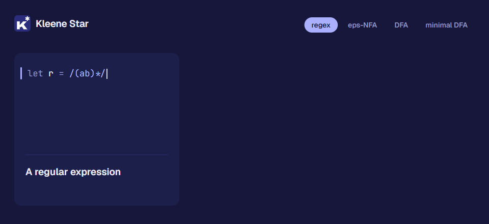

<p align="center"></p>

# Kleene Star

A small language for Theory of Computation, named after the star in `a*`.
The command is `kstar` and programs live in `.kstar` files. You describe
machines the way you draw them on paper, then ask questions about them.

<p align="center"></p>

```kstar
alphabet B = {0, 1}

nfa EndsIn01 over B {
    start  a
    accept c
    a --0,1--> a
    a --0-->   b
    b --1-->   c
}

let d = minimize(EndsIn01)

print d
test d accepts "1101"
test equivalent(d, /(0|1)*01/)
```

```text
DFA with 3 states over {0, 1}
          | 0     | 1
->  {a}   | {a,b} | {a}
    {a,b} | {a,b} | {a,c}
   *{a,c} | {a,b} | {a}
tests: 2 passed, 0 failed
```

## What it can do

- **Define** DFAs, NFAs, eps-NFAs, regular expressions and finite languages.
- **Test** which strings a language accepts.
- **Convert** between them: regex to eps-NFA to NFA to DFA to minimal DFA, and back to a regex.
- **Combine** languages: union, intersection, difference, complement, concatenation, star, reversal.
- **Compare** languages: equivalence and emptiness.
- **Draw** state diagrams as Graphviz files.
- **Trace** a run step by step: states, sets of states, or a PDA's stack.
- **Go beyond regular languages** with context-free grammars (CNF, CYK,
  derivations) and pushdown automata.
- **Run Turing machines**, with a step limit that explains the halting problem
  instead of hanging.
- **Split programs into files** with `import "utils.kstar"` and
  `from utils import f`, and use the standard library (`std.math`) without
  any import.
- **Export** a DFA, or anything regular, as a standalone Rust function with
  `kstar export` or `to_rust`.
- **Catch mistakes early**: a DFA that is missing a transition, a symbol outside
  the alphabet, or a type mix-up is reported before the program runs, with the
  exact place underlined and a hint.

## Installing

Each [release](https://github.com/Pratham71/kleene-star/releases) has
`kstar` and its language server `kstar-lsp` for these platforms, plus a
Windows installer and the VS Code extension:

| Platform | Download |
|---|---|
| Windows x64 | `kstar-setup-x64.exe` (installer) or `kstar-x86_64-pc-windows-msvc.zip` |
| Linux x64 | `kstar-x86_64-unknown-linux-gnu.tar.gz` |
| macOS, Intel | `kstar-x86_64-apple-darwin.tar.gz` |
| macOS, Apple Silicon | `kstar-aarch64-apple-darwin.tar.gz` |
| VS Code | `kleene-star-<version>.vsix` |

Every file has a `.sha256` checksum beside it, and `SHA256SUMS` lists them all.
Nothing else is needed: the programs are self-contained (no Rust, and on
Windows, from 0.2.5-beta on, no Visual C++ Redistributable).

The newest build is **0.2.5-beta**, a pre-release with imports between files,
the `std.math` library and `kstar export`. GitHub's "latest release" (and so
the scripts below, by default) is still 0.2.3; download the beta from its
release page or install it with `KSTAR_VERSION=v0.2.5-beta`.

### With the Windows installer

Download and run `kstar-setup-x64.exe`. It installs for your user, so it
needs no administrator rights. It adds `kstar` to the PATH (a ticked option),
gives `.kstar` files the K* icon, adds a Start Menu entry for the REPL, and,
if VS Code is installed, installs the Kleene Star extension in it (also a
ticked option). Uninstall it from Settings > Apps; that also removes the
PATH entry, the file association and the extension.

### With a script

On Windows, in PowerShell:

```bash
powershell -c "irm https://raw.githubusercontent.com/Pratham71/kleene-star/main/install.ps1 | iex"
```

On Linux or macOS:

```bash
curl -fsSL https://raw.githubusercontent.com/Pratham71/kleene-star/main/install.sh | sh
```

The scripts pick the build for your system, check its SHA-256 checksum,
install it in your user folder (`%LOCALAPPDATA%\Programs\Kleene Star\bin`
or `~/.kstar/bin`), add that folder to the PATH and print how to
uninstall. They install the latest stable release; `KSTAR_VERSION=v0.2.5-beta`
installs a particular one, such as the beta.

### From source

You need [Rust](https://rustup.rs). Then, in this folder:

```bash
cargo install --path .
```

That puts `kstar` and `kstar-lsp` in `~/.cargo/bin`. To try it without
installing, use `cargo run -- <command>` instead of `kstar <command>`.

### The editor extension

```bash
code --install-extension kleene-star-0.2.5-beta.vsix
```

It finds `kstar-lsp` on the PATH or in any of the folders above, and gives
you errors as you type, hover, go to definition, an outline, formatting
and commands to run, check and trace. See [its README](editors/vscode/README.md).

`kstar version` shows what is installed and `kstar update --check` whether
there is a newer release.

## Quick start

```bash
kstar new hello
```

```bash
kstar run hello.kstar
```

```bash
kstar repl
```

`kstar new` writes a small working program to start from. `kstar run`
runs programs, `kstar check` only looks for errors and warnings, `kstar fmt`
tidies their layout, `kstar trace` follows one machine on one word, `kstar export` writes a
machine as Rust code, and
`kstar repl` gives you an interactive prompt. Each takes several files or
folders, `kstar explain E0404` explains an error code, and `kstar help`
lists the rest. The exit code is 0 when there were no errors and no failed
tests. The examples in [examples/](examples) are a good next step:

```bash
kstar run examples/tour.kstar
```

## Learning the language

1. [Deterministic machines](docs/tutorial/01-dfa.md)
2. [Nondeterminism and eps moves](docs/tutorial/02-nfa.md)
3. [Regular expressions](docs/tutorial/03-regex.md)
4. [Combining and comparing languages](docs/tutorial/04-closure.md)
5. [Functions and machine families](docs/tutorial/05-functions.md)
6. [Watching a machine run](docs/tutorial/06-trace.md)
7. [Grammars and pushdown automata](docs/tutorial/07-context-free.md)
8. [Turing machines](docs/tutorial/08-turing.md)
9. [Programs in several files](docs/tutorial/09-modules.md)

Appendix: [tools](docs/tutorial/tools.md), including `kstar fmt` and the `kstar-lsp`
language server ([VS Code extension](editors/vscode/README.md)).

Then keep [the reference](docs/reference.md) open: every statement, type,
built-in function and error on one page.

If you want to know how the interpreter itself works, read
[internals](docs/internals.md). The design decisions are in
[design](docs/design.md).

## When something goes wrong

Errors point at the problem and usually suggest a fix. Every error in the
file is reported at once, each with a code that `kstar explain` describes
in full ([all codes](docs/errors.md)):

```kstar-error
alphabet B = {0, 1}

dfa Broken over B {
    start  q0
    accept q1
    q0 --0--> q1
    q1 --0,1--> q1
}
```

```text
Error in demo.kstar, line 3:
    dfa Broken over B {
    ^^^^^^^^^^^^^^^^^
MachineError[E0404]: DFA `Broken` is not total: no transition from `q0` on `1`
  hint: a DFA needs a transition from every state on every symbol; add the missing ones (often to a dead state), or use `nfa`
```

Errors that happen while running show the chain of calls, most recent last:

```text
Traceback (most recent call last):
  demo.kstar, line 20, in <main>
    test smallest(0) accepts "110"
  demo.kstar, line 16, in smallest
    return minimize(div_by(n))
  demo.kstar, line 9, in div_by
    q[i] --0--> q[(2 * i) % n]
                  ^^^^^^^^^^^
MathError: modulo by zero
  hint: the right-hand side of `%` is 0 here
```

## Project layout

```text
src/automata/   the machines and algorithms, as a plain Rust library
src/lang/       the language: lexer, parser, checker, interpreter, formatter, lints
src/ide.rs      analysis for editors, used by the language server
src/main.rs     the `kstar` command; src/bin/kstar-lsp.rs is the language server
examples/       programs to read and run
tests/          golden, property, robustness, scale, CLI and IDE tests
docs/           tutorial, reference, error catalogue, internals, design
editors/vscode/ the VS Code extension
installer/      the Windows installer; install.ps1 and install.sh are the scripts
assets/         the logo; tools/logo renders the PNG and Windows icon from it
```

Run the tests with `cargo test`. They include every example and every code
sample in the documentation, so the docs cannot fall out of date unnoticed.

## Contributing

Contributions are welcome. [CONTRIBUTING.md](CONTRIBUTING.md) explains how
to build and test, the house rules and how to propose a change, and
everyone taking part follows the [code of conduct](CODE_OF_CONDUCT.md).
To report a security problem, see [SECURITY.md](SECURITY.md).

## How this project was built

The code, tests and documentation were written with
[Claude Code](https://claude.com/claude-code), an AI coding assistant. The
language design and the decisions about it were made by a human, and a
human reviewer was present at each step and approved each change.

Until version 0.2 the project was called TOC-Lang, with `.toc` files and a
`toc` command.

## Licence

[MIT](LICENSE).
